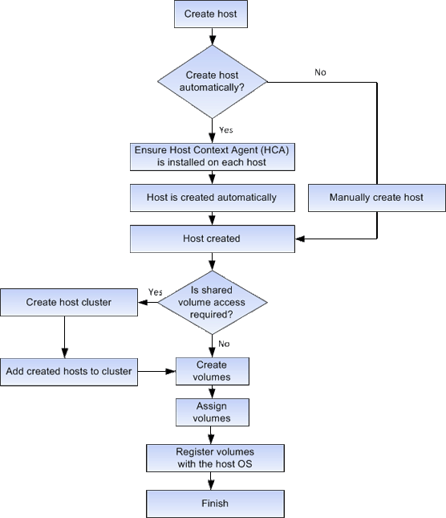

= Flusso di lavoro per la creazione di host e l'assegnazione di volumi in SANtricity System Manager
:allow-uri-read: 
:icons: font
:imagesdir: ../media/

[role="lead"]
La figura seguente illustra come configurare l'accesso all'host.

